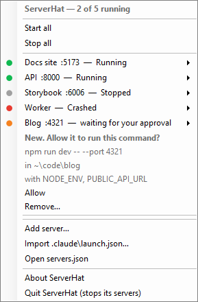
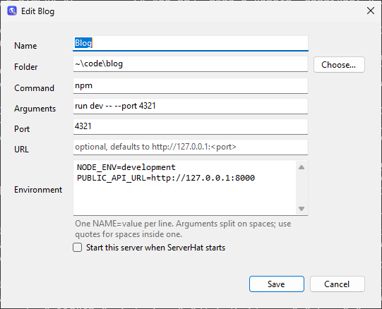
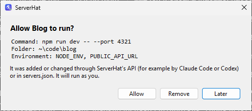

# ServerHat for Windows

**Your local web servers, one click away in the Windows notification area. Free and open source.**

No account, no analytics, nothing leaves your PC.

ServerHat starts, stops, restarts and opens the little web servers you run while you
work (a Node script, `npm run dev`, `python -m http.server`, anything with a command
line), so you never have to keep a terminal window open for them. It also has a local API,
so Claude Code, Codex or your own scripts can add and control servers for you.



macOS version: https://github.com/getguruhat/serverhat-macos. Both use the same
`servers.json` format and the same core API.

### Not on Windows yet

ServerHat for Windows 0.2.3 has the same name, `servers.json` and core API as the Mac app,
but not yet all of its features. These are macOS-only for now:

- The built-in MCP server (`ServerHat --mcp`). Agents use the HTTP API below instead.
- Crash notifications, project import (`package.json`, Procfile, Docker Compose), HTTP health
  checks and the `unhealthy` state, restart after a crash, and export.

## What it does

- A globe in the notification area, with a list of your servers. Each shows whether it's
  **running**, **stopped**, **crashed**, **failed** to start or has its **port in use**,
  and has Start/Stop, Restart, Open in browser, View logs, Edit and Remove. **Start all**
  and **Stop all** are at the top. A green dot on the globe means servers are running, an
  orange one that a command is waiting for your approval, and a red one that one crashed.
- Asks you before running a command that Claude Code, Codex or a script added or changed
  (see [Approval](#approval)).
- Notices when a server crashes (and shows its last line of output) and when its port is
  already taken by something else (and which process that is).
- Keeps a log per server, in the app and in `%LOCALAPPDATA%\ServerHat\Logs\<id>.log`.
- Stores everything in one readable JSON file and picks up edits to it immediately.
- Imports servers from Claude Code's `.claude\launch.json`.
- Finds commands on your `PATH` the way a terminal does, including `.cmd` and `.exe`
  shims such as `npm.cmd`, and reads `PATH` fresh from Windows each time, so a Node or
  Python you just installed is found without signing out.
- Runs each server in its own Job Object, so Stop also ends whatever the server started
  (`npm` → `node` → `vite`), with nothing left behind holding the port.
- Quitting ServerHat stops the servers it started.

## Download

### Windows 10 (1903+) and 11

Download `ServerHat-<version>-Windows-Setup.exe` from the [latest release](../../releases/latest)
and run it. It installs for your user only, without administrator rights. The installer
isn't code-signed yet: if SmartScreen says it protected your PC, choose
**More info › Run anyway**.

Windows 11 may hide new notification-area icons behind the **^** arrow. Drag the globe onto
the taskbar, or turn ServerHat on under **Settings › Personalization › Taskbar › Other system
tray icons**.

## Using it

Click the globe (left or right click) to open the menu. Each server's submenu has Start or
Stop, Restart, Open in browser, View logs, Edit, Open folder and Remove; when something else
holds its port, it also offers to end that process. At the bottom are **Add server**,
**Import .claude\launch.json**, **Open servers.json**, **About ServerHat** and **Quit**.

A server waiting for your approval shows its full command, folder and environment
variable names right in the menu, with **Allow** and **Remove**; see [Approval](#approval).



In a server's Edit window, **Start this server when ServerHat starts** makes it start with
ServerHat, and **Open ServerHat when I sign in to Windows** makes that happen at sign-in
(the installer offers the same).

## The config file

`%APPDATA%\ServerHat\servers.json` (for example
`C:\Users\you\AppData\Roaming\ServerHat\servers.json`):

```json
{
  "servers" : [
    {
      "args" : [
        "ai-experts/server.mjs"
      ],
      "command" : "node",
      "cwd" : "~\\code",
      "env" : {

      },
      "id" : "ai-experts",
      "name" : "AI Experts",
      "port" : 4319,
      "startAtLogin" : false,
      "url" : "http://127.0.0.1:4319"
    }
  ],
  "version" : 1
}
```

| Field | Required | Meaning |
| --- | --- | --- |
| `id` | no | Short unique name used by the API and for the log file. Made from `name` if left out. |
| `name` | yes | What the menu shows. |
| `cwd` | no | Folder the command runs in. `~` and variables such as `%USERPROFILE%` work. Defaults to your user folder. In JSON, write backslashes twice (`"C:\\code\\docs"`) or use forward slashes (`"C:/code/docs"`). |
| `command` | yes | A program on your `PATH` (`node`, `npm`, `python`, `py`) or a path to one. `npm` finds `npm.cmd`, `node` finds `node.exe`. It is run directly, not through a shell, so no pipes or `&&`. |
| `args` | no | Arguments, one string each. |
| `port` | no | The port the server listens on. ServerHat uses it to tell "starting" from "running" and to detect a port that's already in use. |
| `url` | no | What Open in browser opens. Defaults to `http://127.0.0.1:<port>`. |
| `env` | no | Extra environment variables, `{"NAME": "value"}`. |
| `startAtLogin` | no | Start this server whenever ServerHat starts. Turn on **Open ServerHat when I sign in to Windows** (in the server's Edit window) to have that happen at sign-in. |

Save the file and ServerHat reloads it within a second. If the JSON is broken, the menu
says where, and the last good settings stay in use. A server that's running keeps its old
settings until you restart it. Removing a server from the file stops it.

The same file works on both versions; only the folders in `cwd` need to change.

## Import from `.claude\launch.json`

Choose **Import .claude\launch.json…** and pick a project's `.claude\launch.json`. Each
configuration (`{name, runtimeExecutable, runtimeArgs, port, url}`) becomes a server that
runs from the project folder. Configurations that are already in ServerHat are skipped. The
API also accepts the project folder itself.

## API

ServerHat listens on `http://127.0.0.1:47317` (only on this PC). To change the port, set
the DWORD `apiPort` under `HKEY_CURRENT_USER\Software\GuruHat\ServerHat` and restart ServerHat:

```powershell
New-Item -Force HKCU:\Software\GuruHat\ServerHat | Out-Null
Set-ItemProperty HKCU:\Software\GuruHat\ServerHat apiPort 47400 -Type DWord
```

`%APPDATA%\ServerHat\api.json` says where the API is and where its token is:

```json
{ "url": "http://127.0.0.1:47317", "tokenFile": "C:\\Users\\you\\AppData\\Roaming\\ServerHat\\api-token", "configFile": "…\\servers.json" }
```

The routes, the `?wait=` parameter, the JSON and the error messages are the same as in the
macOS version, so a script or agent that works with one works with the other.

### Security

- Every request except `GET /v1/health` needs `Authorization: Bearer <token>`. The token
  is created on first launch in `%APPDATA%\ServerHat\api-token`, readable only by you: the
  file's access list has your user and nobody else, not even Administrators, and doesn't
  inherit from its folder. Delete the file and restart ServerHat to get a new one.
- The `Host` header must be `127.0.0.1:<port>` or `localhost:<port>`, which blocks DNS
  rebinding.
- Requests that carry an `Origin` header, or a `Sec-Fetch-Site` other than `none`, are
  refused, and CORS preflights (`OPTIONS`) are refused, so web pages can't use the API.
- Request bodies must be JSON with `Content-Type: application/json`, at most 1 MB.
- The port is opened exclusively, so no other program can listen on it alongside ServerHat.

Anyone holding the token can add and control servers, which is what the API is for, but
a new or changed command only runs once you allow it (see [Approval](#approval)). Keep the
token out of repositories and logs.

### Setup for the examples

PowerShell:

```powershell
$LW = "http://127.0.0.1:47317"
$TOKEN = (Get-Content "$env:APPDATA\ServerHat\api-token").Trim()
$auth = @{ Authorization = "Bearer $TOKEN" }
```

curl (`curl.exe` comes with Windows 10 and 11; in PowerShell, type `curl.exe`, because
`curl` is an alias for `Invoke-WebRequest` in Windows PowerShell 5.1):

```bat
set LW=http://127.0.0.1:47317
set /p TOKEN=<"%APPDATA%\ServerHat\api-token"
```

### Endpoints

| Method and path | Does |
| --- | --- |
| `GET /v1/health` | `{"ok": true}` without a token; shows ServerHat is running. |
| `GET /v1/servers` | All servers with their status. |
| `POST /v1/servers` | Add a server. Body: the fields above. Returns it with `201`, or `409` if the id is taken. |
| `GET /v1/servers/{id}` | One server with its status. |
| `PATCH /v1/servers/{id}` | Change some fields. `null` clears `port` or `url`. |
| `PUT /v1/servers/{id}` | Replace all fields. |
| `DELETE /v1/servers/{id}` | Stop and remove a server. |
| `POST /v1/servers/{id}/start` | Start it. `409` if its port is already in use, `403` if it's waiting for approval. |
| `POST /v1/servers/{id}/stop` | Stop it (Ctrl+Break to its process group, then its whole Job Object is ended after 5 s). |
| `POST /v1/servers/{id}/restart` | Stop it, then start it again. |
| `GET /v1/servers/{id}/logs?lines=200` | The last lines of its output (up to 5000), plus the log file path. |
| `POST /v1/start-all`, `POST /v1/stop-all` | Start or stop every server. |
| `POST /v1/import` | Body `{"path": "<project folder or launch.json>"}`. Returns `{"added": [...]}`. |
| `POST /v1/reload` | Re-read `servers.json` now. |

Add `?wait=<seconds>` (up to 60) to start, stop and restart to get the answer once the
server is running, stopped or has failed, instead of right away. For a server waiting for
approval, start and restart first wait that long for you to click Allow.

Each server in a response has its settings plus:

```json
"status": { "state": "running", "pid": 8101, "startedAt": "2026-10-30T23:06:47Z" },
"log": "C:\\Users\\you\\AppData\\Local\\ServerHat\\Logs\\ai-experts.log",
"openURL": "http://127.0.0.1:4319"
```

`state` is one of `stopped`, `starting` (launched, port not open yet), `running`,
`stopping`, `crashed` (exited with an error; see `detail` and `exitCode`), `port-in-use`
(something else holds the port; `detail` and `pid` name it) or `failed` (couldn't be
launched, for example command not found). Errors come back as `{"error": "…"}` with a
4xx status.

### Approval

A server added through the API, or by editing `servers.json`, can't start until you allow
it. The same goes for an existing server whose `command`, `args`, `cwd` or `env` changes
(name, port, url and `startAtLogin` don't count). ServerHat shows one notification for each
pending command fingerprint; it shows the command and folder, and clicking it opens
**Allow**, **Remove** and **Later** choices. The menu shows the server with its full
command, folder and environment names, and **Allow** and **Remove**. Servers you add or
edit in ServerHat's own windows, or import from its menu, count as allowed. So do the
servers you already had when you updated to a version with approvals.



Until you allow it, `start` and `restart` answer `403` with an explanation. Add
`?wait=<seconds>` and they wait that long for you to click Allow, then go ahead. A
server waiting for you has `"needsApproval": true` in API responses. ServerHat keeps what
you've allowed in the registry (`approvedCommands` under
`HKEY_CURRENT_USER\Software\GuruHat\ServerHat`), not in `servers.json`.

### Examples

PowerShell (`Invoke-RestMethod` turns the JSON into objects):

```powershell
# Add a server and start it, waiting until it's listening
$body = @{ name = "Docs preview"; cwd = "~\code\docs"; command = "npm"; args = @("run", "dev"); port = 5173; env = @{ BROWSER = "none" } } | ConvertTo-Json
Invoke-RestMethod -Method Post "$LW/v1/servers" -Headers $auth -ContentType "application/json" -Body $body
Invoke-RestMethod -Method Post "$LW/v1/servers/docs-preview/start?wait=30" -Headers $auth

# What's running?
(Invoke-RestMethod "$LW/v1/servers" -Headers $auth).servers | Select-Object id, @{ n = "state"; e = { $_.status.state } }, openURL

# Why did it crash?
(Invoke-RestMethod "$LW/v1/servers/docs-preview/logs?lines=50" -Headers $auth).lines

# Change the port, then restart
Invoke-RestMethod -Method Patch "$LW/v1/servers/docs-preview" -Headers $auth -ContentType "application/json" -Body '{"port": 5174}'
Invoke-RestMethod -Method Post "$LW/v1/servers/docs-preview/restart?wait=30" -Headers $auth

# Import a project's .claude\launch.json
Invoke-RestMethod -Method Post "$LW/v1/import" -Headers $auth -ContentType "application/json" -Body (@{ path = "$HOME\code\docs" } | ConvertTo-Json)
```

curl, in Command Prompt (Git Bash and WSL can use the macOS README's examples as they are,
with the token from `$APPDATA/ServerHat/api-token`):

```bat
curl -s -H "Authorization: Bearer %TOKEN%" -H "Content-Type: application/json" -X POST %LW%/v1/servers -d "{\"name\": \"Docs preview\", \"cwd\": \"~/code/docs\", \"command\": \"npm\", \"args\": [\"run\", \"dev\"], \"port\": 5173}"
curl -s -H "Authorization: Bearer %TOKEN%" -X POST "%LW%/v1/servers/docs-preview/start?wait=30"
curl -s -H "Authorization: Bearer %TOKEN%" %LW%/v1/servers
curl -s -H "Authorization: Bearer %TOKEN%" "%LW%/v1/servers/docs-preview/logs?lines=50"
curl -s -H "Authorization: Bearer %TOKEN%" -H "Content-Type: application/json" -X PATCH %LW%/v1/servers/docs-preview -d "{\"port\": 5174}"
curl -s -H "Authorization: Bearer %TOKEN%" -X POST "%LW%/v1/servers/docs-preview/restart?wait=30"
```

## Build from source

GitHub Actions builds it on every push, runs the smoke test, and packages it with Inno
Setup, so nothing needs to be installed locally. To build on your own PC, you need the
.NET 8 SDK (only as the compiler). The app targets .NET Framework 4.8, which comes with
Windows 10 and 11, so the build is a small folder (`ServerHat.exe`, its `.config`, and the
System.Text.Json DLLs) rather than a self-contained runtime.

```powershell
dotnet publish ServerHat.csproj -c Release -o publish
publish\ServerHat.exe --smoke-test   # writes smoke-test.log; exit code 0 means it passed
```

The smoke test runs the real server manager and API in a temporary folder: it starts a
server through a `.cmd` shim, checks it's running, that Stop ends its whole process tree,
that crashes, missing commands and ports in use are reported, that arguments survive
`cmd.exe` quoting, that edits to `servers.json` are picked up, that new and changed
commands wait for approval, and that the API's answers match the macOS version's bytes.

To publish a release, set the version in `ServerHat.csproj` and `installer.iss`, write
`RELEASE_NOTES.md`, and push a matching tag, such as `git tag v0.2.3 && git push origin v0.2.3`.

`ServerHat.exe --screenshots <folder>` takes the pictures in `docs/`, with a few example
servers. Run the **README screenshots** workflow (`gh workflow run screenshots.yml`) to
take them on Windows, then copy the ones you want from its artifact.

The code:

- `Config.cs`: the servers.json format, the file watcher, and the launch.json importer.
- `Json.cs`: JSON written in exactly the macOS version's layout.
- `ServerManager.cs`: starting and stopping servers, crash and port detection, command
  approval.
- `Processes.cs`: `CreateProcess` with a Job Object, `PATH`/`PATHEXT` lookup, argument
  quoting for programs and batch files, and the TCP listener table.
- `ApiServer.cs`, `TokenFile.cs`: the local HTTP API and its token.
- `Program.cs`: the notification-area icon and menu. `Windows.cs`: the log, edit and
  approval windows. `AboutWindow.cs`: the About window.
- `SmokeTest.cs`, `Screenshots.cs`: `--smoke-test` and `--screenshots`.

## Support

ServerHat is free. If it saves you time, you can
[support GuruHat with a donation](https://www.paypal.com/donate/?hosted_button_id=FHGYWD46722JS).

## License

MIT. See [LICENSE](LICENSE).
